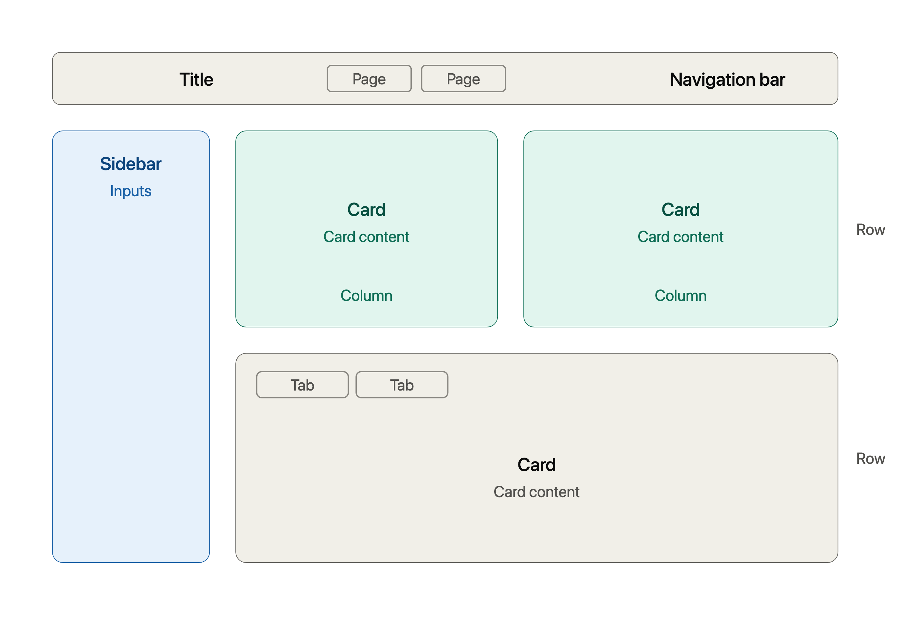

:::::::::::::::::::::::::::::::::::::: questions
- Why are dashboards a useful way to present OA monitoring data?
- What is Quarto, and how is a Quarto document structured?
- What are the main components of a Quarto dashboard?
::::::::::::::::::::::::::::::::::::::::::::::::

::::::::::::::::::::::::::::::::::::: objectives
- Explain why dashboards are useful for OA monitoring
- Describe what Quarto is and name the main components of a Quarto document
- Describe what a Quarto dashboard is and how it relates to other Quarto output formats
- Describe the main building blocks of a Quarto dashboard
::::::::::::::::::::::::::::::::::::::::::::::::

## Why dashboards for OA monitoring?

A dashboard presents the most important information about a topic on a single screen, so it can
be understood at a glance, rather than requiring someone to read through a long report. In the context 
of Open Access (OA) this is useful for:

- **Monitoring**: keeping an eye on numbers that change over time, for example how many of your
  institution's publications are Open Access this year compared to last year, or how
  article processing charge (APC) spending develops across publishers
- **Communicating with non-technical audiences**: a library director, university management or a
  funding body wants the headline numbers ("our OA share is now 62%") instead of the analysis
  code or a lengthy statistical report
- **Supporting negotiations and decisions**: libraries can use dashboards to track transformative
  agreements with publishers (how much is spent vs. how many articles are published open access
  under that deal), which directly informs whether an agreement is worth renewing
- **Staying up to date automatically**: because a Quarto dashboard is generated from code,
  re-running it against new data (for example an updated export from your repository or a
  bibliometric database) produces an updated dashboard, without rebuilding it by hand


## What is Quarto?

[Quarto](https://quarto.org/) is an open-source, multi-language publishing system. 
It combines plain text written in [Markdown](https://www.markdownguide.org/getting-started/) with code (in R, or other languages like Python or Julia) 
to produce a finished document. Quarto documents can be written in several editors, 
such as [RStudio](https://posit.co/downloads), [JupyterLab](https://jupyter.org/#jupyterlab-a-next-generation-notebook-interface), 
and [Visual Studio Code](https://code.visualstudio.com/), so Quarto isn't tied to
R and RStudio specifically.

With Quarto the same underlying document can be rendered into many output formats: HTML pages,
PDFs, Word documents, presentations, websites, books and, as we will see, dashboards. Which one
you get depends on the `format` you choose; everything else about how you write the document
stays more or less the same.

This lesson only covers what you need to build a dashboard. Quarto itself is much bigger. If you
would like a fuller introduction, two good starting points are the official Quarto
[Get Started guide](https://quarto.org/docs/get-started/) and the Carpentries Incubator lesson
[Reproducible Publications with Quarto](https://carpentries-incubator.github.io/reproducible-publications-quarto/).


## The anatomy of a Quarto document

A Quarto document is a plain-text file with the extension `.qmd`. It consists of three
main components:

````markdown
---
title: "My first document"
format: html
---

## A heading

Some text with **bold** words.

``` r
1 + 1
```
````

1. **A YAML header** at the very top, between two lines of three dashes (`---`). It holds
   settings for the whole document, such as the title and the output format.
2. **Markdown text**, which gives the document its structure (headings, lists, links, images).
   We practise Markdown syntax in the next episode.
3. **Code chunks**, which run code and put the result (a number, a table, a chart) into the
   document. We meet them in a later episode.

When you *render*  the file, Quarto runs the code, combines the results with the text and writes
the output file, for example a `.html` file. Change the data or the code, render again, and you
get an updated document.

::: callout
### What is YAML?

YAML ("YAML Ain't Markup Language") is a human-readable format for writing settings as
`key: value` pairs. It is not specific to Quarto; many tools use it for configuration files.

- Each setting is written as `key: value`
- Indentation (using spaces, not tabs) shows that one setting belongs *inside* another
- In a Quarto document, the YAML block is marked off by three dashes (`---`) at the start and end
:::

## What is a Quarto dashboard?

A Quarto **dashboard** is one of several predefined **output formats**
built into Quarto. Under the hood, a dashboard is essentially a regular HTML 
page with a predefined layout: instead of flowing top to bottom like a
report, your content is arranged into a grid of rows, columns and cards. Setting the `format`
option in the YAML header to `dashboard` is all it takes:

````yaml
---
title: "My OA Dashboard"
format: dashboard
---
````

## Components of a Quarto dashboard

<div class="figure" style="text-align: center">

<p class="caption">The main components of a Quarto dashboard: <br/> navigation bar, sidebar, rows, columns, cards, pages and tabsets</p>
</div>


Let us go through the components we will build in this lesson:

**Navigation bar**: the bar at the top of every dashboard. It shows the title (and, later, a
logo) and, if you have more than one page, a tab for each page.

**Pages**: each page is shown as its own tab in the navigation bar. A single-page dashboard
shows no page tabs.

**Rows and columns**: a page is divided into rows (the default) or columns. Rows can be split
further into columns, and columns into rows. In the figure, the two teal cards sit side by side as
*columns* within one *row*, and the grey card below forms a second row on its own. You can switch
the default with the `orientation` setting in the YAML header:

````yaml
format:
  dashboard:
    orientation: columns
````

Note how `orientation` is indented one level further than `dashboard`, and `dashboard` one level
further than `format`. That indentation nests `orientation` *inside* `dashboard`, which is itself
nested *inside* `format`.

**Cards**: the bordered panels that hold your content. The output of every code chunk becomes a
card automatically; you do not have to create them explicitly. Text and images can be put into
cards too.

**Value boxes**: a special kind of card for prominently displaying a single number, such as
"OA share: 62%".

Two further components exist that we will not build in this lesson, but you will meet them in the
Quarto documentation: **sidebars** (a panel at the side, often used for input controls like
dropdown menues or sliders) and **tabsets** (tabs that stack two cards together).

::: callout
### How are these components created?

In a Quarto dashboard, **Markdown headings** define the layout:

- a level 1 heading (`#`) starts a new **page**
- a level 2 heading (`##`) starts a new **row or column**

and **code chunks** produce the content of the cards. We learn the syntax in the next episodes and
use it when we build the dashboard.
:::


::::::::::::::::::::::::::::::::::::: keypoints
- Dashboards present key information at a glance, which is useful for OA monitoring,
  communicating with non-technical audiences, and staying up to date automatically
- A Quarto document has three main components: a YAML header, Markdown text and code chunks
- Setting `format: dashboard` in the YAML header renders the document as a dashboard
- A dashboard consists of a navigation bar, pages, rows, columns and cards; value boxes are
  special cards for a single number
- Markdown headings define the layout, code chunks produce the content
::::::::::::::::::::::::::::::::::::::::::::::::
