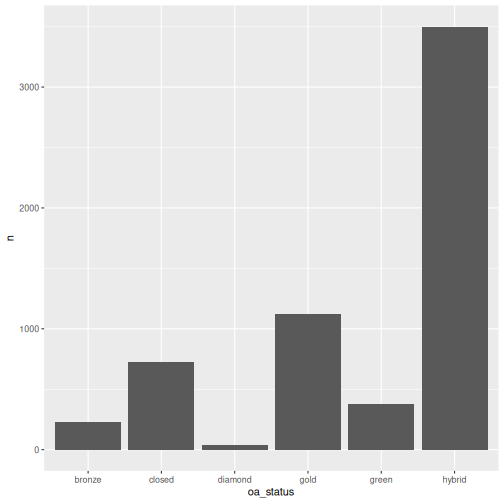
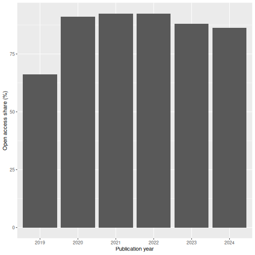
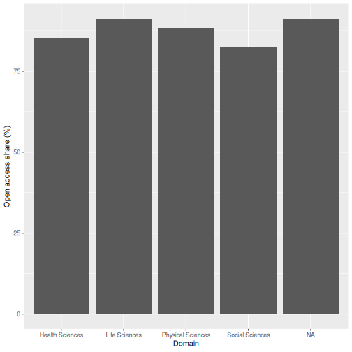

:::::::::::::::::::::::::::::::::::::: questions
- How do you calculate OA indicators and use them in value boxes?
- How do you create a chart with ggplot2 and add it to a dashboard?
- How do you apply the same charting pattern to a different grouping of your data?
::::::::::::::::::::::::::::::::::::::::::::::::

::::::::::::::::::::::::::::::::::::: objectives
- Calculate summary statistics from `oa_df` and use them to populate value boxes
- Create a `ggplot2` chart of the OA share over time, using `group_by()` and `summarise()`
- Apply the same grouping pattern to chart the OA share by research domain
::::::::::::::::::::::::::::::::::::::::::::::::


## Where we are so far

In the skeleton episode, we built a dashboard with all its components but only placeholder
content. In the data episode, we filtered the data to one institution, saved it as `oa_df` and created the column `is_oa`. 
Now we bring the two together and replace the placeholder content with calculations from our data.

Make sure the setup chunk from the previous episode has been run, so that `oa_df` exists in your session.

## Calculating values for the value boxes

Recall the three value boxes from the dashboard skeleton episode. Each one ended with a placeholder value. We
first work out the three numbers, one line at a time. You can try each in the Console.

**Total publications** is the number of rows in `oa_df`. The `nrow()` function gives us exactly that number:


``` r
nrow(oa_df)
```

``` output
[1] 5992
```

**Total OA publications:** `is_oa` is `TRUE` for OA articles. R treats `TRUE` as `1` and `FALSE` as
`0`, so using the `sum()` function on the `is_oa` column sums up the OA articles:


``` r
sum(oa_df$is_oa)
```

``` output
[1] 5264
```

**Open access share:** the `mean()` function applied to a column with logical values (`TRUE`/`FALSE`) returns the proportion of `TRUE` values. Multiply
by 100 to get the percentage value:


``` r
mean(oa_df$is_oa) * 100
```

``` output
[1] 87.85047
```

::: callout
### A handy trick: `mean()` of a logical column
A column of `TRUE`/`FALSE` values is turned into `1`/`0` when you do arithmetic with it. The *sum*
is therefore the number of `TRUE` values and the *mean* is the proportion of `TRUE` values. This is
a common shortcut for "what share of rows meet this condition?". You will use it again for the
chart.
:::

We now replace the placeholder line in each value box of our dashboard. Only the **last line** of
each chunk changes; the chunk options stay the same:

```r
#| content: valuebox
#| title: "Total Publications"
#| icon: book
#| color: primary

nrow(oa_df)
```

```r
#| content: valuebox
#| title: "Open Access Publications"
#| icon: unlock
#| color: success

sum(oa_df$is_oa)
```

```r
#| content: valuebox
#| title: "Open Access Share"
#| icon: percent
#| color: warning


round(mean(oa_df$is_oa) * 100, 2)
```

In the last box, `round()` limits the share to two decimal places. Click **Render**, the three boxes should now show real
numbers calculated from our data.

::::::::::::::::::::::::::::::::::::: challenge
## Challenge 1: A fourth value box

Your colleagues responsible for the transformative agreements ask you: *How many different
transformative agreements (`esac_id`) appear in our data?* Add a fourth value box titled
"Transformative Agreements" to the first row. Set the icon to `file-earmark-text` and the color to `info`.
The `n_distinct()` function counts the number of distinct values.

:::::::::::::::::::::::: solution
## Solution


``` r
n_distinct(oa_df$esac_id)
```

``` output
[1] 25
```

```r
#| content: valuebox
#| title: "Transformative Agreements"
#| icon: file-earmark-text
#| color: info

n_distinct(oa_df$esac_id)
```
:::::::::::::::::::::::::::::::::
::::::::::::::::::::::::::::::::::::::::::::::::

## A very short introduction to plotting with ggplot2

`ggplot2` (also part of the `tidyverse`) builds charts in layers. Every `ggplot2` chart starts
the same way:

```r
ggplot(data, aes(x = ..., y = ...)) +
  geom_...()
```

- `ggplot(data, ...)` starts the chart and says which data frame to use
- `aes()` ("aesthetic mapping") says which columns map to which parts of the chart, typically
  `x` and `y`
- `geom_...()` says what kind of chart to draw, for example `geom_col()` for bars, `geom_line()`
  for a line chart or `geom_point()` for a scatter plot
- Layers are combined with `+`, not the pipe `|>`

As a first example, let us chart how many articles fall into each `oa_status`:


``` r
oa_df |>
  count(oa_status) |>
  ggplot(aes(x = oa_status, y = n)) +
  geom_col()
```



The pipe `|>` feeds the counted data into `ggplot()` as its first argument, exactly like it fed
data into `filter()` or `summarise()` before. Only after the `ggplot()` call do we switch to
`+` for adding layers.

## Visualizing the OA share over time

Let us use the same building blocks to answer a more specific monitoring question: *How has the
OA share changed by publication year?* First we calculate the OA share per year with `group_by()`
and `summarise()`, using the same `mean()` trick as before:


``` r
oa_df |>
  group_by(publication_year) |>
  summarise(oa_share = mean(is_oa) * 100)
```

``` output
# A tibble: 6 × 2
  publication_year oa_share
             <dbl>    <dbl>
1             2019     66.3
2             2020     91.1
3             2021     92.3
4             2022     92.5
5             2023     88.0
6             2024     86.3
```

Now we feed the result into `ggplot()` using the pipe operator:


``` r
oa_df |>
  group_by(publication_year) |>
  summarise(oa_share = mean(is_oa) * 100) |> 
  ggplot(aes(x = factor(publication_year), y = oa_share)) +
  geom_col() +
  labs(x = "Publication year", y = "Open access share (%)")
```



Two details: `factor(publication_year)` tells R to treat each year as a category, so every bar gets
its own label on the x axis. `labs()` sets readable axis labels; without it the axes would show
the raw column names (`publication_year`, `oa_share`).

To add the chart to the dashboard, replace the placeholder chunk in the **left column** of the
second row of the "Overview" page. The chunk contains both the calculation and the chart, and the
`title` option gives the card its title:

```r
#| title: "Open Access Share by Publication Year"
oa_df |>
  group_by(publication_year) |>
  summarise(oa_share = mean(is_oa) * 100) |> 
  ggplot(aes(x = factor(publication_year), y = oa_share)) +
  geom_col() +
  labs(x = "Publication year", y = "Open access share (%)")
```

Render the dashboard and check the result.

::::::::::::::::::::::::::::::::::::: challenge
## Challenge 2: OA share by research domain

Your director asks: *In which research domain is our OA share highest?* Reuse the pattern above to
calculate the OA share per `domain` and add the chart in a new chunk below the first chart, 
with the title “Open Access Share by Research Domain”. This time you do not need to use `factor()`.

:::::::::::::::::::::::: hint
You have to change the grouping column: `group_by(domain)` instead of
`group_by(publication_year)`, and `x = domain` in `aes()`. If the labels overlap, add
`+ coord_flip()` to turn the bars sideways.
:::::::::::::::::::::::::::::

:::::::::::::::::::::::: solution
## Solution


``` r
oa_df |>
  group_by(domain) |>
  summarise(oa_share = mean(is_oa) * 100) |> 
  ggplot(aes(x = domain, y = oa_share)) +
  geom_col() +
  labs(x = "Domain", y = "Open access share (%)")
```



The same `group_by()` + `summarise()` + `ggplot()` pattern works for any grouping column.
:::::::::::::::::::::::::::::::::
::::::::::::::::::::::::::::::::::::::::::::::::

::::::::::::::::::::::::::::::::::::: keypoints
- `sum()` and `mean()` of a `TRUE`/`FALSE` column give the count and the proportion of `TRUE`
  values
- A `ggplot2` chart starts with `ggplot(data, aes(x, y))`, followed by a `geom_...()` layer,
  joined with `+`
- The same `group_by()` + `summarise()` + `ggplot()` pattern works for any grouping column
::::::::::::::::::::::::::::::::::::::::::::::::
